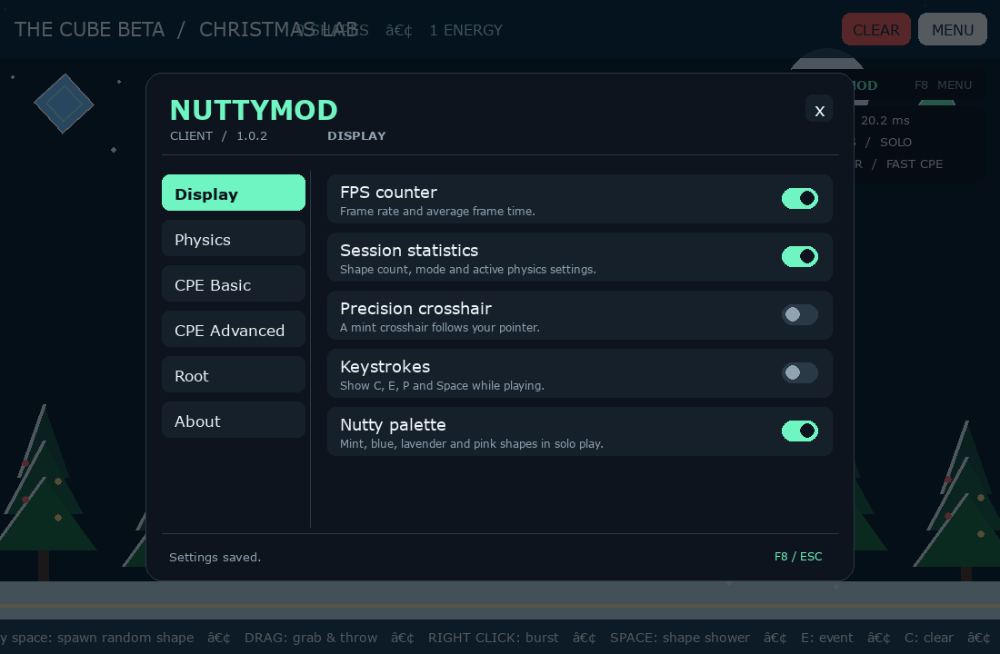
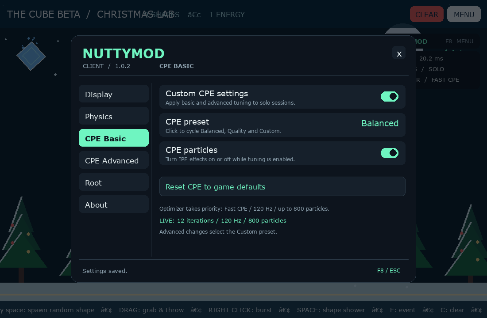
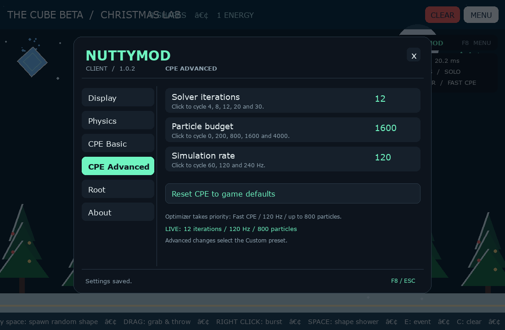
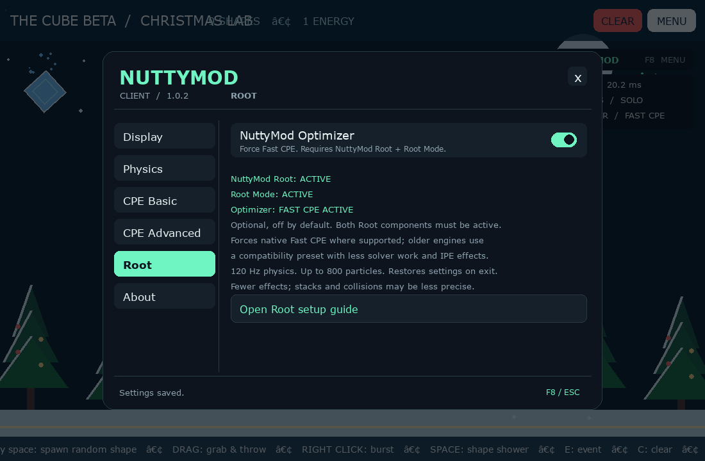

# NuttyMod Client for The Cube Beta

**Get [CPE Flasher Tool](https://nuttyinc578.github.io/CPE-flashing-tool/) to install NuttyMod Client.**

NuttyMod Client 1.0.2 adds Basic and Advanced CPE settings, plus an optional
NuttyMod Optimizer under Root. The F8 menu also includes HUD options, a mint
palette and solo physics controls. Install the client TAR using the
flasher's **05 Custom Cube** tab, then rebuild the game.

[Download client TAR](https://github.com/nuttyinc578/nuttymod-client-for-the-cube-beta/raw/refs/heads/main/downloads/NuttyMod-Client-1.0.2.tar)
· [Download ZIP with guide and preview](https://github.com/nuttyinc578/nuttymod-client-for-the-cube-beta/raw/refs/heads/main/downloads/NuttyMod-Client-1.0.2.zip)
· [SHA-256 checksums](downloads/SHA256SUMS.txt)
· [Installation guide](docs/INSTALL.md)



## Features

- FPS counter, average frame time, shape count and session mode.
- Optional pointer crosshair and C/E/P/Space keystroke display.
- Mint, blue, lavender and pink shapes in solo play.
- Solo low gravity, half-speed physics, spawn eight shapes and clear shapes.
- Local settings at `userdata/nuttymod-client/settings.json`, with a reset button.
- About page linking to the CPE Flasher Tool website.
- **CPE Basic:** enable custom tuning, choose Balanced/Quality/Custom presets,
  and toggle IPE particles.
- **CPE Advanced:** solver iterations, particle budget and simulation rate,
  with live engine readings and a reset to game defaults.
- **Root → NuttyMod Optimizer:** optional Fast CPE enforcement. Requires both
  **NuttyMod Root** and **Root Mode** active in the running game.

Physics changes and session actions apply to solo play. Multiplayer keeps the
game's existing host/guest physics rules. The client leaves CPELoader checks
and the flasher's update policy in place.

## Install

1. Get **[CPE Flasher Tool](https://nuttyinc578.github.io/CPE-flashing-tool/)**
   and download the client TAR above. If you download the ZIP, extract it first.
2. Keep an original official Cube Beta portable ZIP. Open your installed game,
   press **Ctrl+A**, choose **Y** to unlock CPELoader, then close the game.
3. Configure the flasher's original game ZIP, installed game folder, matching
   complete game source, Python compiler and userdata. Enable **Full rewrite**.
4. In **05 Custom Cube**, browse to `NuttyMod-Client-1.0.2.tar`.
5. Click **Flash ZIP + Recompile**, then install the completed build.
6. Launch the game, acknowledge the loader warnings, and press **F8**.

The rebuild requires Python 3.11+ with pygame, pymunk and PyInstaller.
The TAR contains client code; the game and compiler are separate downloads.
The client works with bundled Rephysics and optional CPE Series 2 — Ortain.
NuttyMod Root is optional for the client and normal CPE settings. The optimizer
requires NuttyMod Root and Root Mode; the legacy isolated NuttyMod loader is
not required.

## CPE settings and NuttyMod Optimizer

Open **F8 → CPE Basic** to enable custom CPE tuning. Choosing a preset or changing
an advanced value enables tuning automatically. **Balanced** uses 12 solver
iterations and a 1600-particle budget. **Quality** uses 30 iterations and a
4000-particle budget. Both use 120 Hz physics. **Custom** uses your advanced
values. Disable custom tuning or choose **Reset CPE to game defaults** to restore
the configuration captured when the solo session started.

| Advanced setting | Choices |
| --- | --- |
| Solver iterations | 4, 8, 12, 20, 30 |
| Particle budget | 0, 200, 800, 1600, 4000 |
| Simulation rate | 60, 120, 240 Hz |

The live readout shows applied values. Rephysics internally caps its solver
loop at 8 iterations; selecting a larger value does not increase that limit.

The optimizer is **off by default**. Install matching NuttyMod Root and Root Mode
packages through the flasher's **03 Root** tab following its
[Root installation guide](https://github.com/nuttyinc578/CPE-flashing-tool/blob/main/NUTTYMOD_ROOT.md),
then rebuild with the client TAR selected. In game, open **F8 → Root** and check
that both components show **ACTIVE** before enabling **NuttyMod Optimizer**.

The optimizer reasserts native Fast CPE every frame where that API is available,
including the game's shared Fast CPE setting. Older supported engines use a
compatibility preset. It keeps 120 Hz physics, caps native solver work at 12
iterations (6 for the compatibility preset), and limits particles to at most
800. Lower manual budgets remain respected. This takes priority over advanced
tuning while enabled. Reducing solver work and effects trades collision precision
and visual detail for less processing work.

The dependency check runs before applying the optimizer, including when loading
a saved preference. If either Root component becomes inactive, the forced mode
is released. Disabling it restores your manual CPE tuning or game defaults;
leaving solo play restores the original engine and shared Fast CPE settings.
Multiplayer keeps the game's existing configuration.





## Controls

| Control | Action |
| --- | --- |
| F8 | Open or close NuttyMod Client |
| Esc while the menu is open | Close the client menu |
| Tab while the menu is open | Next page |
| Mouse | Select a page, toggle settings, or use solo session actions |

The simulation continues while the menu is open. The client consumes menu
clicks and keystrokes so they do not affect gameplay behind it.
F11 and CPELoader's Ctrl+A shortcut retain their existing behavior.

Use **Restore backup** in CPE Flasher Tool to return to the previous installation.

## Build and test

```sh
python tools/build.py
python -m pip install -r requirements-dev.txt
python -m unittest discover -s tests -v
```

The builder uses Python's standard library. It creates the deterministic client
TAR, ZIP and checksums under `downloads/`. Tests use pygame with a headless display.
The GitHub Actions workflow tests the client and verifies the committed downloads
on Windows and Linux. The release workflow can publish matching assets when a
`v1.0.2` tag is pushed.

Source: [python/nuttymod_client.py](python/nuttymod_client.py).
The original repository's [CC0 license](LICENSE) is preserved.

For offline integration QA against a local complete game source, run
`python tools/verify_game.py --game-source /path/to/the-cube`. It uses a temporary
copy, disables the bridge, checks native and Rephysics engines, and saves menu
previews. Root availability is supplied as a test fixture; the tool does not
install Root or change the original game.
